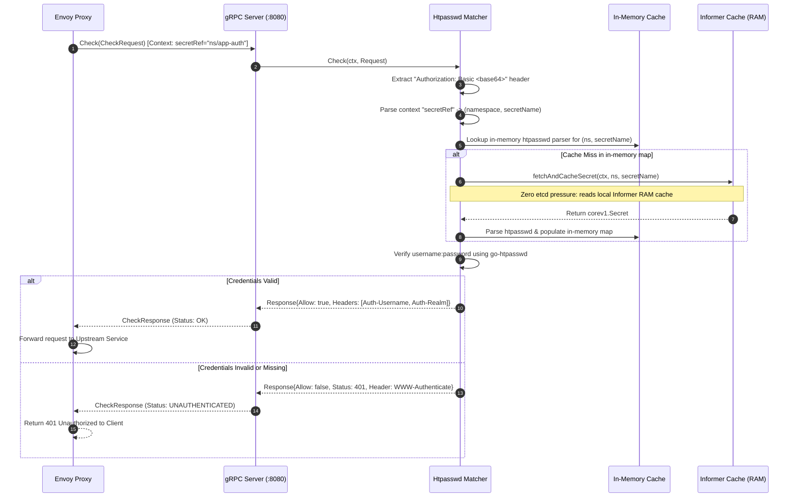
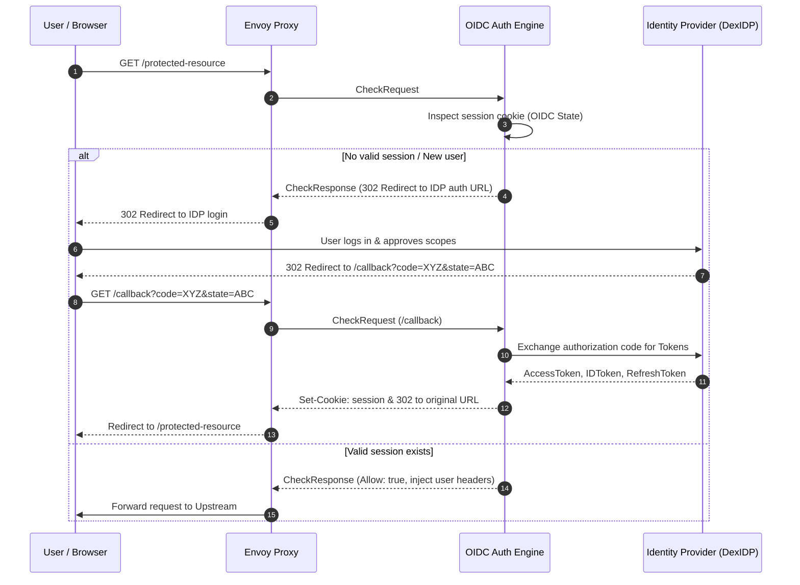
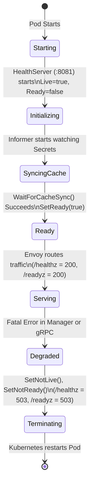

# Architecture & Developer Guide: contour-auth-multi-tenant

This document provides a developer-friendly overview, architectural diagrams, component maps, and request lifecycle flows for **`contour-auth-multi-tenant`**.

---

## 1. High-Level System Architecture

`contour-auth-multi-tenant` is an external authorization (`ext_authz`) gRPC microservice designed to integrate with [Envoy Proxy](https://www.envoyproxy.io/) and [Project Contour](https://projectcontour.io/). It operates as a sidecar or a dedicated authorization deployment within Kubernetes clusters.

```mermaid
flowchart TD
    Client(["🌐 Client / Browser"])
    Kubelet(["☸️ Kubelet Probes"])
    KubeAPI[("☸️ Kubernetes API Server")]

    subgraph IngressLayer ["Ingress & Routing Layer"]
        Envoy["Envoy Proxy (Data Plane)"]
        Contour["Contour Operator / Controller"]
        Contour -.->|Configures ext_authz filter| Envoy
    end

    subgraph AuthServer ["contour-auth-multi-tenant"]
        direction TB
        gRPCServer["gRPC Auth Server (:8080)\n• v2 & v3 AuthorizationServer\n• gRPC Keepalive (Anti-Zombie)"]
        HealthServer["HTTP Health Server (:8081)\n• /healthz (Liveness)\n• /readyz (Readiness)"]
        
        subgraph CoreEngines ["Auth Engines"]
            HtpasswdEngine["htpasswd Engine\n(Multi-Tenant Basic Auth)"]
            OIDCEngine["OIDC Engine\n(OAuth2 / DexIDP SSO)"]
        end

        InformerCache[("Local Informer Cache\n(In-Memory K8s Secrets)")]
        LocalSecretMap[("In-Memory Secret Parsers\n(sync.Map & go-htpasswd)")]
    end

    UpstreamApp["🚀 Protected Upstream Service"]

    %% Flow
    Client -->|1. HTTP Request| Envoy
    Kubelet -->|GET /healthz, /readyz| HealthServer
    KubeAPI -.->|Watch Secrets (Filtered by label)| InformerCache
    InformerCache -->|Reconcile events| LocalSecretMap

    Envoy -->|2. CheckRequest (gRPC v3/v2)\nContext: secretRef=ns/secret| gRPCServer
    gRPCServer --> CoreEngines
    HtpasswdEngine -->|3. Lookup Secret| LocalSecretMap
    LocalSecretMap -.->|On-demand Fallback if missing| InformerCache
    CoreEngines -->|4. CheckResponse (Allow / Deny)| gRPCServer
    gRPCServer -->|5. Status: OK or UNAUTHENTICATED| Envoy

    Envoy -->|6a. If OK: Forward Request + Headers| UpstreamApp
    Envoy -->|6b. If Denied: Return 401/302| Client
```

---

## 2. Directory & Package Map

```
contour-auth-multi-tenant/
├── main.go                     # Application entrypoint & CLI bootstrapper
├── ARCHITECTURE.md             # This architecture documentation
├── README.md                   # User documentation and usage examples
├── Dockerfile                  # Container build definition
├── Makefile                    # Build and test automation
│
└── pkg/
    ├── auth/                   # Core authorization protocols and engines
    │   ├── convert.go          # Envoy CheckRequest/Response adapters (v2 & v3)
    │   ├── htpasswd.go         # Basic Auth reconciler & multi-tenant matcher
    │   ├── oidc_connect.go     # OIDC/OAuth2 authentication engine
    │   └── server.go           # gRPC ext_authz server & HTTP HealthChecker
    │
    ├── cli/                    # Cobra command-line definitions & flags
    │   ├── defaults.go         # Shared flags, gRPC keepalive parameters, TLS config
    │   ├── err.go              # Standard exit codes & error wrappers
    │   ├── htpasswd.go         # 'htpasswd' subcommand wiring & manager lifecycle
    │   └── oidc_connect.go     # 'oidc' subcommand wiring
    │
    ├── config/                 # Configuration structs
    │   └── config.go           # OIDC YAML configuration schemas
    │
    ├── store/                  # Ephemeral state stores
    │   └── state.go            # OIDC OAuth2 flow state token management
    │
    └── version/                # Build metadata
        └── version.go          # Version, Git SHA, and build date
```

### Package Responsibilities

| Package | Purpose | Key Interfaces & Types |
| :--- | :--- | :--- |
| `pkg/auth` | Implements Envoy's `AuthorizationServer` (v2/v3), htpasswd verification, and OIDC token flows. | `Checker`, `Htpasswd`, `OIDCAuth`, `HealthChecker` |
| `pkg/cli` | Command-line parsing via Cobra, controller-runtime manager setup, and concurrent service execution. | `NewHtpasswdCommand()`, `NewOIDCConnect()`, `Defaults()` |
| `pkg/store` | In-memory token and OAuth state tracking for OIDC callback flows. | `OIDCState`, `ConvertToByte()`, `ConvertToType()` |
| `pkg/config` | Deserialization of OIDC configuration files/ConfigMaps. | `OIDCConfig` |
| `pkg/version` | Injected build-time metadata. | `Version`, `Sha`, `BuildDate` |

---

## 3. Core Engine 1: `htpasswd` (Multi-Tenant Basic Auth)

### How Multi-Tenancy Works
Standard `contour-authserver` tests credentials against all secrets in the cluster. In contrast, `contour-auth-multi-tenant` provides **tenant isolation**:
1. In Contour's `HTTPProxy`, an `authPolicy` defines a `secretRef`:
   ```yaml
   virtualhost:
     authorization:
       authPolicy:
         context:
           secretRef: "my-tenant-ns/my-app-auth"
   ```
2. Envoy transmits this reference in `CheckRequest.Attributes.ContextExtensions["secretRef"]`.
3. `Htpasswd.MatchContext()` retrieves credentials **only** against the specified Secret.

### htpasswd Request Flow



### Kubernetes Secret Synchronization
- The `Htpasswd` struct implements controller-runtime's `reconcile.Reconciler`.
- It watches `corev1.Secret` resources filtered by `--selector` (default: `auth.contour.snappcloud.io/type=basic`).
- When a secret is created, updated, or deleted, `Reconcile` parses the htpasswd data into an in-memory `sync.Map` of `*htpasswd.File` instances.
- **Data Protection**: Syntax errors in htpasswd lines are sanitized to ensure passwords are never leaked into container logs.

---

## 4. Core Engine 2: `oidc` (OpenID Connect / Single Sign-On)

The `oidc` subcommand provides browser-based SSO authentication using standard OpenID Connect providers (e.g., DexIDP, Keycloak, Okta, Google).



---

## 5. Resilience & High Availability

### 1. Zombie Connection Prevention (gRPC Keepalives)
Envoy and the auth server communicate over long-lived HTTP/2 TCP streams. Intermediate firewalls, cloud NATs, and Kubernetes conntrack tables can silently drop idle TCP sockets without sending `RST`/`FIN`.
To prevent silent connection hangs, `pkg/cli/defaults.go` enforces:
- **`MaxConnectionAge: 30m`**: Periodically drains connections gracefully and forces Envoy to reconnect and load-balance.
- **`MaxConnectionAgeGrace: 5m`**: Allows in-flight checks to finish before closing.
- **`Time: 1m` / `Timeout: 5s`**: Actively sends gRPC PING frames every minute to detect dead connections.
- **`PermitWithoutStream: true`**: Keeps keepalives running even without active RPC streams.

### 2. Zero-Pressure Informer Fallback
If an Envoy request references a newly created secret before the Informer's event loop finishes, the server performs an on-demand fallback lookup via `h.Client.Get(...)`. Because `controller-runtime` delegates client queries to the local cache, **no network load or pressure is exerted on the Kubernetes API server or `etcd`**.

### 3. Dual-Probe Health Lifecycle



---

## 6. Developer Quick-Start

### Prerequisites
- Go 1.22+
- `make`
- A Kubernetes cluster (for local testing, [KinD](https://kind.sigs.k8s.io/) or [Minikube](https://minikube.sigs.k8s.io/))

### Common Commands

```bash
# 1. Run all unit tests
make test
# or directly with go
go test -v -race ./...

# 2. Build the binary
make build
# Binary is generated at bin/contour-auth-multi-tenant

# 3. Run htpasswd server locally (connects to your KUBECONFIG)
./bin/contour-auth-multi-tenant htpasswd \
  --address :8080 \
  --metrics-address :8081 \
  --auth-realm "SnappCloud" \
  --watch-namespaces default,demo

# 4. Check health endpoints
curl -i http://localhost:8081/healthz
curl -i http://localhost:8081/readyz
```
